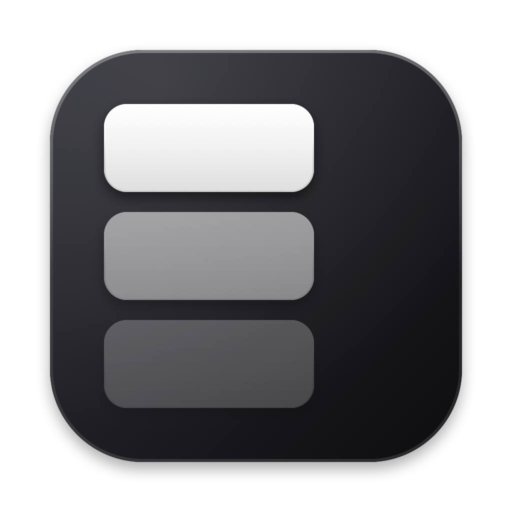
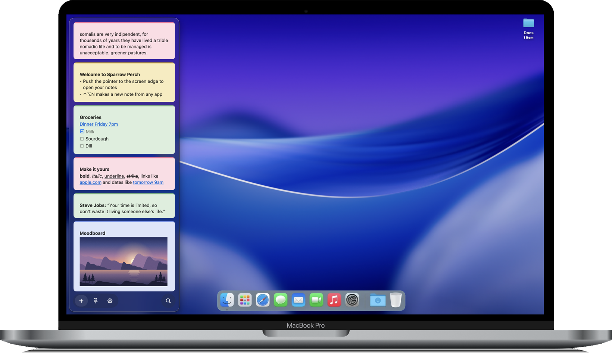
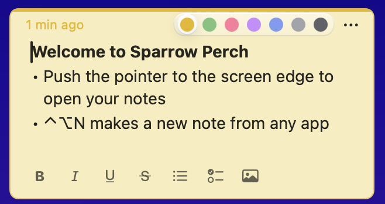
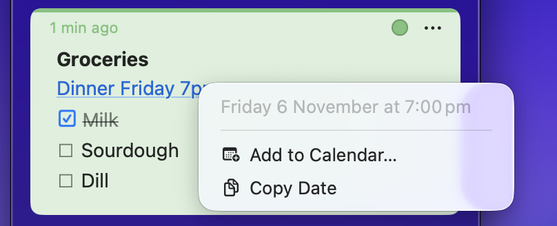

  

<h1 align="center">Sparrow Perch</h1>

<h3 align="center">Notes that wait at the edge.</h3>

  Push the pointer to the side of your screen. 
  Your notes slide out. Move away, and they're gone.

  

For Apple silicon and Intel Macs.

 

  

 

<h2 align="center">Out of sight. One push away.</h2>

  No windows to find. No desktop to tidy.

  

 

<h2 align="center">Just start typing.</h2>

  Lists, checklists and pictures. Seven colours.

  

 

<h2 align="center">Dates that do something.</h2>

  Write "Friday 7pm". Click it. It's in your calendar.

  

 

<h2 align="center">Yours alone.</h2>

  Your notes stay on your Mac. 
  No account. No cloud. No tracking.

 

---

<h3 align="center">Install</h3>

  Open <b>Sparrow-Perch.dmg</b> and drag the app to <b>Applications</b>. 
  The first time, macOS asks. Go to <b>System Settings ▸ Privacy & Security</b> and click <b>Open Anyway</b>.

  <b>⌃⌥S</b> Show your notes &nbsp;·&nbsp; <b>⌃⌥N</b> New note, from any app

 

  

